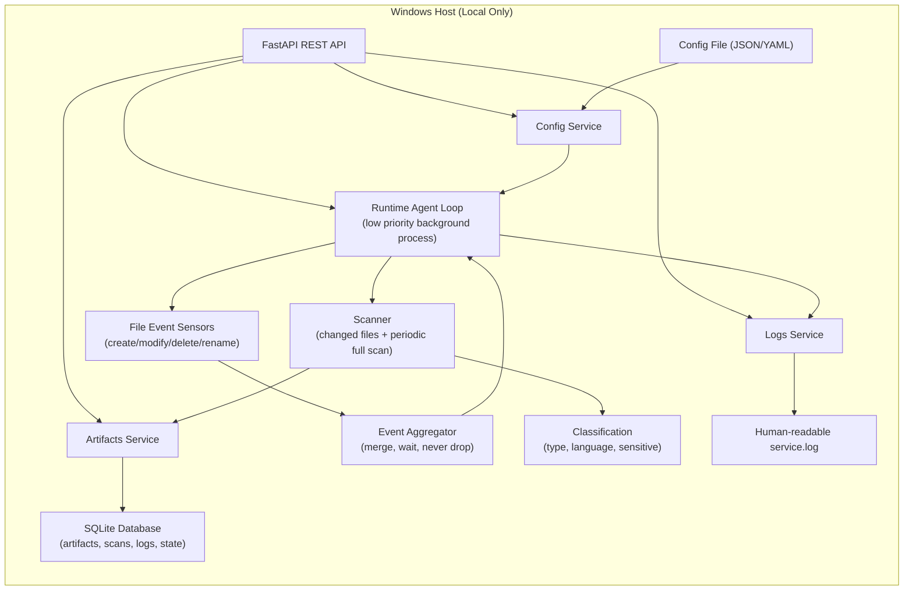

# code-steward-agent

## AI model testing

This standalone lab tests how well local AI models explain code. Each request contains one file's
source with line numbers and basic facts extracted from the code. The [prompt](ai_lab/settings/explain_prompt.txt)
asks for brief English JSON: purpose, inputs, outputs, usage, dependencies, related files,
important unknowns and code evidence. It tells the model to avoid guessing missing details.
The lab is separate from the project's scanner and API.

1. Install **[Python 3.10+](https://www.python.org/downloads/)** and **[Ollama](https://ollama.com/download)** once. Open Ollama.
2. Put your code files in **`ai_lab/samples/`**. Subfolders work too.
3. Double-click **`Run AI Test.command`** on Mac or **`Run AI Test.bat`** on Windows, then choose a model and CPU or GPU.

The menu offers **Qwen3.5 4B/9B** and **Qwen2.5-Coder 7B/3B**. Qwen3.5 4B remains the default.
Choose **C** to use another model: paste an Ollama model name, run command or model-page link.
You can keep it in the menu for next time without editing configuration files.

The script tests every supported code file in that folder and opens **`report.html`** automatically.
The report presents each explanation with expandable source-line evidence.
Missing models download automatically. The lab reads code; it does not run your scripts.
One status line shows live token speed and system CPU/RAM; each file shows its time and final speed,
and the finished run shows total time. Live speed is marked `~` because it is an estimate.

The folder includes **118 code files** in 12 programming languages: the complete 791-line `a4.py`,
LeetCode solutions, unchanged open-source examples and imitation personal script folders.

**[Guide](docs/AI_TESTING.md)** · **[Test files](docs/AI_TEST_FILES.md)** · **[How the AI code is organized](ai_lab/README.md)**

| AI files | What they are |
|---|---|
| `Run AI Test.command`, `Run AI Test.bat`, `ai_test.py` | Start the test (double-click or command line) |
| `ai_lab/settings/` | Models, limits and prompts |
| `ai_lab/samples/` | The code to test |
| `ai_lab/explain/`, `ai_lab/testing/` | The program: explain one file; test many files and write reports |
| `ai-results/` | One folder per run (created locally, not in Git); open `report.html` |

<details>
<summary>Command-line options for developers</summary>

```sh
# Same model settings as the double-click launcher
python3 ai_test.py run --model qwen-4b --pull

# Compare Qwen3.5 4B and 9B on the same development cases
python3 ai_test.py compare --config ai_lab/settings/default.json --models qwen-4b qwen-9b --suite dev --pull

# Test another folder or a different local model
python3 ai_test.py run --input /path/to/code --model MODEL_TAG --pull

# Preview the result layout without a model
python3 ai_test.py demo
```

The launcher uses `ai_lab/settings/default.json`: CPU by default (GPU only as a marked preview), thinking off, complete source text,
up to 60,000 characters per file, 32K context and a 2,048-token generation ceiling.
Actual explanations are kept short by the prompt and field limits. Long files can take several minutes.
These settings have not been certified for an 8GB PC.
The older `ai_lab/settings/legacy.json` remains available for the existing short-file benchmark and input checks.
The input folder is fixed at `ai_lab/samples/`; change files there, no list needs updating.
Personal models added through the menu are stored in the Git-ignored `ai_lab/settings/models.local.json`.
They do not change the shared presets or inference settings.

`report.html` and `report.md` are readable results. `summary.md`, JSON files and CSV files retain technical
records and optional manual scoring. A generated explanation is not an automatic correctness score.
[Benchmark sets](ai_lab/benchmarks/README.md).

</details>

## Dependencies

- **Python**
- **FastAPI**: API framework
  - defines the API
- **Uvicorn**: starts a server (`localhost:8000`), listens for requests, passes them to FastAPI, returns responses
  - runs the API

## How to install and run

### Create virtual env

```
python3 -m venv venv
source venv/bin/activate    # Mac/Linux
venv\Scripts\activate       # Windows
```

### Install dependencies

```
pip install -r requirements.txt
```

### Run the server

```
uvicorn CodeSteward:app
```

- CodeSteward = filename
- app = FastAPI instance
- The background service starts together with the API (`service.auto_start` in `config.yaml`).
  Press Ctrl+C to stop both; the service finishes its current step first.
- Add `--reload` only while editing the code: it restarts the server whenever a project file changes.

### Send requests with curl

The default URL is `http://127.0.0.1:8000` or `http://localhost:8000`.

E.g.,

```
curl http://localhost:8000
```

```
curl http://127.0.0.1:8000/system/health
```

## Generated docs

http://localhost:8000/docs

## MVP API Skeleton

Current endpoints (details and examples at `/docs`). Errors are JSON: `{"detail": "..."}`.

| Endpoint | What it does |
|---|---|
| `GET /system/health` | Health check |
| `GET /system/status` | Service state, waiting file changes, file watcher state, last background error |
| `GET /system/metrics` | CPU time, CPU share since the previous call, peak memory and threads of the agent |
| `POST /system/start`, `/stop`, `/pause`, `/resume` | Control the background service; 409 when not possible (for example pause while stopped) |
| `GET /scan/status` | Running scan, counts of the last scan, last full scan time, root folder availability |
| `POST /scan/trigger` | Queue a full scan (202); 409 while the service is stopped or paused |
| `GET /artifacts` | One page of saved files: `limit`, `offset`; filters `artifact_type`, `language`, `sensitive`, `path_contains` |
| `GET /artifacts/{artifact_id}` | One file with its classification and exact duplicates (`same_content_as`); 404 when unknown |
| `GET /events/status` | File changes waiting to be checked, and how folders are watched |
| `POST /events/inject` | Simulate a file event for tests; 403 unless `testing.allow_event_injection: true` |
| `GET /logs?limit=100` | Recent log entries (see Runtime logs) |
| `GET /config` | Current settings with defaults; passwords, tokens and keys shown as `***` |
| `POST /config/reload` | Read `config.yaml` again; 422 with the reason when invalid (the old settings stay) |

## Verify artifact classification

1. Set `scanning.root_paths` in `config.yaml` to a test folder and start the API.
   The service starts by itself and scans the folder once.
2. Create, edit, rename or delete a file inside that folder: code, documents, data or programs.
3. After a few seconds call `GET /artifacts`. Each file shows its name, path, size, hash,
   change type and classification:
   - `artifact_type`: wrapper, script, binary, sample, data, documentation or unknown
   - `language` (or format), `is_binary`, `sensitive` with `sensitive_reason`
   - `confidence` with `classification_reasons` (computed from the evidence, not by AI)
   - `discovered_by`: watcher, injected, or the scan that found it (startup-scan, periodic-scan,
     manual-scan, settings-scan, overflow-scan, retry-scan)

The artifact ID stays the same when a known file is edited (also by editors that save through a
temporary file) or moved, even through several renames. Its hash changes when its contents change.
Files larger than `max_file_size_bytes` are listed without a hash. Files are read, never run.

## How file changes are handled

```
FileEventService ──> EventAggregator ──> CodeStewardService loop ──> ScanService ──> ArtifactsService
   (watcher)          (waits, merges)       (every tick_seconds)       (checks files)     (SQLite)
```

- **Watcher**: the operating system's change events, or polling when they cannot start
  (`watch_mode`). A root that does not exist yet (an unplugged drive) is watched when it appears.
- **Event aggregator**: one waiting item per file. It waits `quiet_seconds` after the last change,
  at most `max_wait_seconds`; above `max_pending_files` it asks for one full scan instead.
  Nothing is lost while a scan runs or the service is paused.
- **Background loop**: checks settled changes each tick. A full scan runs at start, every
  `scan_interval_seconds`, after too many changes, after a settings reload and on `POST /scan/trigger`.
  A failed step is logged and retried with growing pauses, followed by a full scan.
- **Scanner**: a changed file is compared by contents; a full scan reads only files whose size or time
  changed and removes records of files that are gone. It skips `exclude_folders`, system folders and
  `deny_paths`, links, temporary files, and the agent's own folder, database and log.

| To change | Look in |
|---|---|
| Settings, their defaults and checks | `config.yaml`, `Services/ConfigService.py` |
| Which events count, watcher modes | `Services/FileEventService.py` |
| Waiting and merging rules | `Services/EventAggregator.py` |
| What a scan checks, skipped folders and files | `Services/ScanService.py` |
| File types, languages, sensitive rules | `Services/ClassificationService.py` (raise `CLASSIFIER_VERSION`) |
| Database columns and upgrades | `Services/ArtifactsService.py` (raise `SCHEMA_VERSION`) |
| Loop timing, start, stop, pause | `service.py` |
| How the services are connected | `Services/ServiceContainer.py` |

## Saved artifact records

Artifact records are saved automatically in `artifacts.sqlite3` in the project
directory (`storage.database_path`). Restarting the API keeps the records and their IDs.
SQLite is included with Python, so the existing installation commands still work.

The existing `ArtifactsService` handles saving and querying. `ScanService` uses
these saved records to check which files have changed. Each record keeps the full
JSON shown by the API plus searchable columns (hash, size, time, type, language,
sensitive) with indexes. An older database is upgraded automatically at start
(`PRAGMA user_version` 2); its records and IDs are kept and its files are classified
at the first scan.

The old `scan_checkpoint.json` does not contain complete artifact records or IDs,
so it is ignored when the artifact service is connected. The scanner still supports
that JSON file when used without an artifact service.

To check persistence:

1. Set `scanning.root_paths` in `config.yaml` to your test folder and start the API.
2. Call `GET /artifacts` and note a file's ID.
3. Stop the API, then edit one file and delete another.
4. Start the API again. The start-up scan finds both changes; the edited file keeps its ID.

The database contains the latest file information. File contents stay in their
original locations. Keep the database to keep these records; Git ignores the
database and its temporary files. The scanner skips its own database files.

Run the regression tests from the project directory:

```sh
python -m unittest discover -s tests -v
```

`tests/test_file_events.py` covers the event aggregator, scanner and background loop, including
a few seconds with the real file watcher. `tests/test_api.py` starts a real server with temporary
settings, database and log, and checks every endpoint's answers and a clean shutdown.

## Runtime logs

`GET /logs` reads real application events from `service.log` in the project
directory (`storage.log_path`). Entries survive server restarts and are returned newest first.
The existing plain-text history is also readable. New entries include a UTC
timestamp, severity, source module and message; old entries retain their original
local timestamps and have `source: null` when no source was recorded.
Multiline exception details stay with the event that produced them.

Query parameters:

- `limit`: maximum matching entries, from 1 to 1000; default 100.
- `level`: optional exact level: DEBUG, INFO, WARNING, ERROR or CRITICAL.
- `search`: optional case-insensitive message text, up to 200 characters.

Filters apply before the limit. `count` is the number returned, not the total
number of historical entries. No matches return an empty list with HTTP 200.
Invalid parameters return HTTP 422. An unreadable log file returns HTTP 503
with a short explanation; a missing log file is treated as an empty history.

```sh
curl "http://127.0.0.1:8000/logs?limit=20"
curl "http://127.0.0.1:8000/logs?limit=20&level=WARNING&search=blocked"
```

The logger captures scanning requests and results, file changes, service
controls, skipped paths, blocked scans and errors. File-type exclusions are
summarized per scan. Idle ticks and raw watcher events are DEBUG messages and are
not recorded at the default INFO level, so a burst of file events does not bury
useful entries; each changed file and each scan result is an INFO entry.
`logging.level` sets the detail. The file starts over at `logging.max_bytes` and keeps
`logging.backup_count` older files (`service.log.1`, ...); `GET /logs` reads the current
file. Filters with no matches may need to scan the full history.

To verify in `/docs`, open `GET /logs`, choose **Try it out**, set `limit` to 20,
then choose **Execute**. Look under **Server response / Response body**.
Pause the service, request a scan, and query with `level=WARNING` and
`search=blocked`: the rejected scan and its reason should appear. Resume the
service after this check. Reading logs does not itself generate application
log records. Execute the query again to refresh; the page does not auto-update.

The automated suite includes temporary-file log tests and real HTTP tests of
the logs controller. Run `python -m unittest discover -s tests -v` after installing
the existing requirements; no additional test dependency is needed.

## MVP: A Local-First Architecture



Database note:

- SQLite is a good MVP default for local logs and metadata.
- Single-file DB keeps install simple and works offline.
- You can split into tables like: `artifacts`, `scan_runs`, `file_events`, `logs`, `agent_state`.
