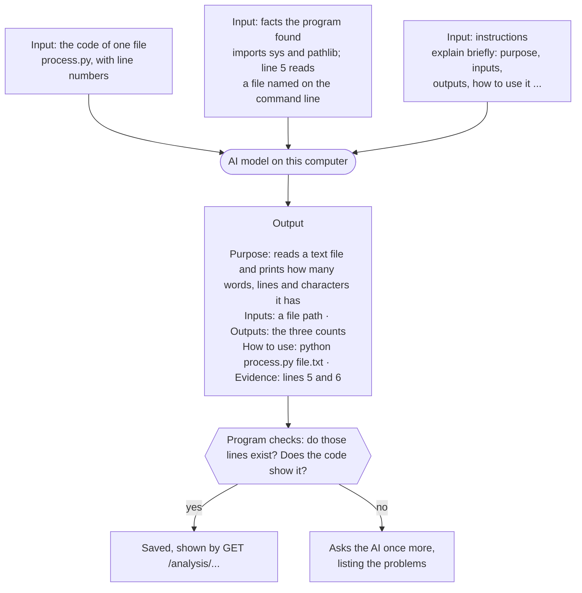
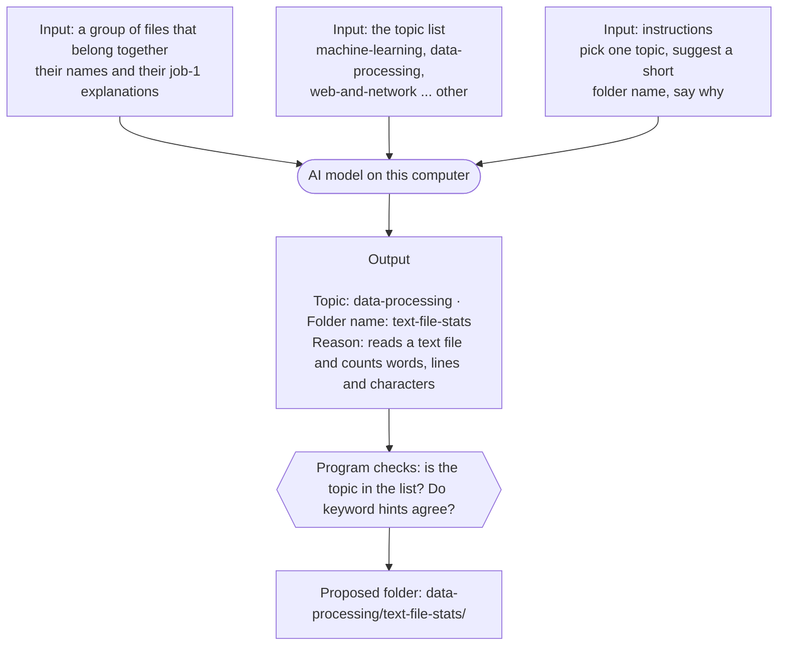
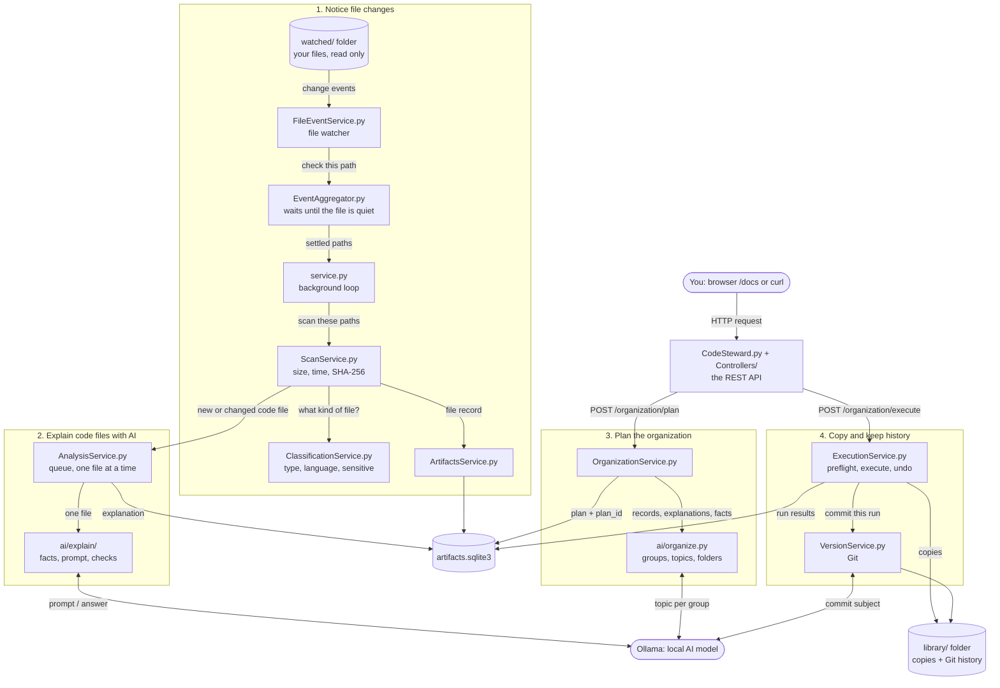
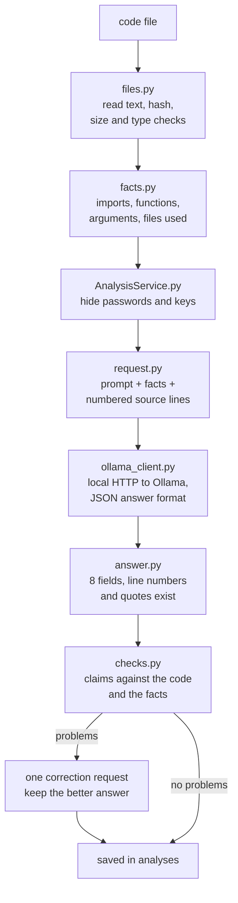
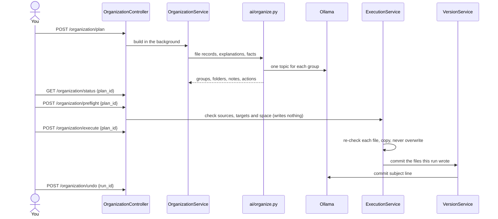

# How Code Steward works

This page starts with the core of the project, how the AI is used, in plain words. Then it explains every
file of the program and what it hands to the next one: the whole picture, one file followed through the
system, and tables to find any file.

## The AI in plain words

Code Steward uses a local AI model (Qwen3.5 4B through Ollama, on your own computer) for three small jobs.
Each time, the program gives the model something to read plus short instructions, and gets back a short
answer in a fixed form. The program then checks the answer before using it.

### Job 1: explain a code file

A real example from testing: the first line of `process.py` is a comment that says *This file trains a
neural network*, which is deliberately wrong. The AI went by the code itself and answered that the script
counts words, lines and characters.

### Job 2: choose a topic folder for a group of files

When the keyword hints disagree, the group is listed under "Check these first" on the plan page. When there
is no usable answer, the keyword hints choose the topic. Nothing is copied until you execute the plan.

### Job 3: describe a change in the library's history

The program tells the AI which folders a run changed; the AI answers with a few words that name the kind
of code, for example *word-count script in data-processing folder*. The program puts its own verb in front
("Organize", "Update"), so the Git history reads *Update word-count script in data-processing folder*.

### In short

| Job | We give the AI | We get back | Used for |
|---|---|---|---|
| Explain a file | The code with line numbers, facts the program found, instructions | Purpose, inputs, outputs, how to use it, dependencies, related files, what is unclear, evidence lines | `GET /analysis/...`, the notes in the library, job 2 |
| Choose a topic | A group's file names and explanations, the topic list, instructions | Topic, folder name, one-sentence reason | The organization plan |
| Describe a change | The folders a run changed | A few words | The Git commit subject |

What the AI never does: it never sees files outside the watched folders, never gets passwords or keys
(they are replaced with `<hidden>` first), never runs any code, and never sends anything to the internet.
Every answer is checked by the program before it is used.

## The whole picture

Everything runs inside one Python process started by `uvicorn CodeSteward:app`. The API answers requests
while a background loop and two worker threads (AI explanations; plan building or copying) do the work.

## Follow one file through the system

Say you save `train.py` in the watched folder.

1. **The watcher notices it.** `FileEventService.py` gets the operating system's change event and hands
   "check `train.py`" to `EventAggregator.py`.
2. **It waits until the file is quiet.** Editors often write a file several times. The aggregator keeps
   one waiting item per file and releases it after 2 seconds without changes (at most 30 seconds).
3. **The background loop picks it up.** Every 5 seconds `service.py` takes the settled paths and gives
   them to `ScanService.py`. It also runs a full scan at start and every 5 minutes, which catches anything
   the watcher missed.
4. **The scanner records it.** `ScanService.py` checks that the path is allowed (inside a watched folder,
   not a system or denied folder, not reached through a link), reads size, time and SHA-256 hash, asks
   `ClassificationService.py` what kind of file it is, and saves the record through `ArtifactsService.py`
   into the `artifacts` table. A renamed file keeps its ID. Then it tells its listeners.
5. **The AI queue takes code files.** `AnalysisService.py` is a listener: scripts and launchers are put in
   the `analysis_jobs` queue (a newer version replaces a waiting older one; a deleted file leaves the queue).
6. **The worker explains it.** One file at a time, when Ollama is ready (running, model installed, local,
   no other model loaded):
   - `ai/explain/files.py` reads the text; `ai/explain/facts.py` collects facts without running anything.
   - `AnalysisService.py` replaces passwords, keys and tokens written in the code with `<hidden>`.
   - `ai/explain/pipeline.py` asks the model and checks the answer (details in the next picture).
   - The explanation is saved in `analyses`, keyed by the file contents, extension and a "profile" (model
     version, prompt and settings). An unchanged or duplicate file is never sent again.
7. **You build a plan.** `POST /organization/plan` makes `OrganizationService.py` read every file again,
   collect each file's type, explanation and facts, and call `ai/organize.py`. Files that an earlier run
   already copied keep their library folder (`ExecutionService.placements()`), so a changed `train.py`
   updates its copy instead of appearing in a new folder. The plan (with its `plan_id`) is saved in
   `organization_plans`. Nothing is copied yet.
8. **You execute the reviewed plan.** `ExecutionService.py` copies the files into the library, checking
   each source and target again first, and records every action in `execution_runs`.
9. **The history is committed.** `VersionService.py` commits exactly the files that run wrote to the
   library's Git repository; the model writes the subject line.

## Inside the AI explanation

`pipeline.py` (`result_for`) runs this chain for one file and returns the answer with its timing, token
counts and any problems the program found. The answer has eight short fields: purpose, inputs, outputs,
usage, dependencies, related files, unknowns, and evidence (line numbers with a short claim).

## Planning, copying and history

## Every file

### Starting and the API

| File | What it does | Gets from | Passes to |
|---|---|---|---|
| `CodeSteward.py` | Creates the FastAPI app, adds the controllers, starts the background service with the API and stops it cleanly | `uvicorn` | Controllers |
| `Controllers/SystemController.py` | `/system/*`: health, status, metrics, start, stop, pause, resume | HTTP | `service.py`, `SystemService.py` |
| `Controllers/ScanController.py` | `/scan/*`: scan status, ask for a full scan | HTTP | `ScanService.py`, `service.py` |
| `Controllers/ArtifactsController.py` | `/artifacts`: the saved files, with filters and pages | HTTP | `ArtifactsService.py` |
| `Controllers/AnalysisController.py` | `/analysis/*`: AI progress and explanations | HTTP | `AnalysisService.py` |
| `Controllers/OrganizationController.py` | `/organization/*`: plan, page, preflight, execute, runs, undo, repository | HTTP | `OrganizationService.py`, `ExecutionService.py` |
| `Controllers/EventsController.py` | `/events/*`: waiting changes; simulated changes for validation | HTTP | `EventAggregator.py` |
| `Controllers/LogsController.py` | `/logs`: recent log entries | HTTP | `LogsService.py` |
| `Controllers/ConfigController.py` | `/config`: show and reload settings | HTTP | `ConfigService.py` |
| `Services/ServiceContainer.py` | Creates every service once and connects them (who tells whom about changes) | settings | every service |
| `config.yaml` | All settings, with a comment for each | you | `ConfigService.py` |
| `Services/ConfigService.py` | Reads and checks `config.yaml`, fills defaults, picks the Windows or Mac paths, reloads | `config.yaml` | every service |

### Noticing and recording files

| File | What it does | Gets from | Passes to |
|---|---|---|---|
| `service.py` | The background loop: every tick it scans settled changes; full scans at start, periodically and on request; pause, resume, stop; retries after errors | `EventAggregator.py` | `ScanService.py` |
| `Services/FileEventService.py` | Watches the folders with the operating system's change events (or polling); watches a folder again when a missing drive returns | the operating system | `EventAggregator.py` |
| `Services/EventAggregator.py` | One waiting item per file; releases it when quiet; many changes at once become one full scan | watcher events | `service.py` |
| `Services/ScanService.py` | Decides which files are in scope; compares size, time and hash; finds new, changed, renamed and deleted files; never reads the library or system folders | paths | `ClassificationService.py`, `ArtifactsService.py`, `AnalysisService.py` |
| `Services/ClassificationService.py` | Program rules (no AI): type, language, binary, sensitive, and a confidence with reasons | file name and first bytes | `ScanService.py` |
| `Services/ArtifactsService.py` | The `artifacts` table: one record per file, IDs kept through edits and renames, searches for the API | records | `artifacts.sqlite3` |

### Explaining code with AI

| File | What it does | Gets from | Passes to |
|---|---|---|---|
| `Services/AnalysisService.py` | The AI queue and worker: waits for Ollama, hides secrets, saves answers by contents and profile, explains files again after a model or prompt change | changed files from `ScanService.py` | `ai/explain/`, `artifacts.sqlite3` |
| `ai/explain/files.py` | Reads one file for the model: text and hash; refuses links, binaries, empty and too long files | a path | `facts.py` |
| `ai/explain/facts.py` | Facts read from the code without running it: imports, functions and classes, arguments, main block, files used (Python in detail, other languages by patterns) | source text | `request.py`, `checks.py` |
| `ai/explain/request.py` | What the model receives: the prompt, the facts and the numbered source lines | file + facts | `ollama_client.py` |
| `ai/explain/ollama_client.py` | Talks to Ollama on this computer only (no cloud, no redirects); sends the request with the answer format; CPU or GPU | messages | Ollama |
| `ai/explain/answer.py` | The answer format (eight fields) and its checks: valid JSON, existing line numbers, true quotes | the model's answer | `pipeline.py` |
| `ai/explain/checks.py` | Checks each claim against the code and facts (for example invented dependencies or commands), fills empty parts from facts, writes the correction request | answer + facts | `pipeline.py` |
| `ai/explain/pipeline.py` | `result_for()`: ask, check, correct at most once; returns the answer, timing and tokens | a file | `AnalysisService.py` |
| `ai/explain/config.py` | Loads and checks the AI settings; turns `qwen-4b` into the Ollama model name | `ai/settings/default.json` | `AnalysisService.py` |
| `ai/common.py` | Shared helpers: the `AIError` type, hashes, reading JSON | | all of `ai/` |
| `ai/settings/default.json` | Model names and limits: context size, answer length, file size, timeout | you | `config.py` |
| `ai/settings/explain_prompt.txt` | The instructions the model gets for every explanation | you | `request.py` |

### Planning the organization

| File | What it does | Gets from | Passes to |
|---|---|---|---|
| `Services/OrganizationService.py` | Builds a plan in the background: reads every file again (rescans changed ones), collects types, explanations and facts, asks where earlier runs put each file, calls the organizer per watched folder, saves the plan and its `plan_id`, remembers topic answers | `artifacts`, `analyses`, `execution_runs` | `ai/organize.py`, `organization_plans` |
| `ai/organize.py` | Keeps files that use each other together (imports, launchers, paths written in code, folders with a README or LICENSE), finds duplicates, asks the model for one topic per group and checks it against keyword hints, names folders (a group already in the library keeps its folder), writes the README/notes text, lists the actions, and builds the plan page | file records | `OrganizationService.py` |
| `ai/settings/topics.json` | The topic folders the model chooses from, with descriptions and keyword hints | you | `ai/organize.py` |
| `ai/settings/topic_prompt.txt` | The instructions for choosing a topic | you | `ai/organize.py` |

### Copying and version history

| File | What it does | Gets from | Passes to |
|---|---|---|---|
| `Services/ExecutionService.py` | Preflight, execute and undo of the reviewed `plan_id`: checks every source again (allowed, not a link, same SHA-256), writes a temporary file and publishes it in one step, never overwrites changed files, records every action, recovers after a crash | the saved plan | the library, `VersionService.py`, `execution_runs` |
| `Services/VersionService.py` | The library's private Git repository: creates it, commits only the files a run wrote or removed, never sensitive files or build output, shows and repairs problems. The program chooses the subject's verb ("Organize", "Update", "Undo") and the model names the kinds of code | run results | the library's `.git` |

### Support

| File | What it does |
|---|---|
| `Services/LogsService.py` | Writes `service.log` (time, level, source, message) and reads it back for `/logs` |
| `Services/SystemService.py` | CPU and memory numbers of Code Steward for `/system/metrics` |
| `requirements.txt` | The Python libraries: FastAPI (API), Uvicorn (web server), watchdog (file events), PyYAML (settings), pydantic (request checks) |

## What is stored where

| Data | Where | Written by | Read by |
|---|---|---|---|
| One record per file | `artifacts` table | `ArtifactsService.py` | API, `AnalysisService.py`, `OrganizationService.py` |
| Files waiting for AI | `analysis_jobs` table | `AnalysisService.py` | `AnalysisService.py` |
| AI explanations | `analyses` table (`analysis_models`: model versions) | `AnalysisService.py` | API, `OrganizationService.py` |
| Topic answers | `topic_answers` table | `OrganizationService.py` | `OrganizationService.py` |
| The latest plan | `organization_plans` table | `OrganizationService.py` | API, `ExecutionService.py` |
| Runs and undo | `execution_runs` table | `ExecutionService.py` | API, undo, restart recovery |
| Log | `service.log` | `LogsService.py` | `/logs` |
| Organized copies and history | library folder and its `.git` | `ExecutionService.py`, `VersionService.py` | you, Git |

All tables are in `artifacts.sqlite3` in the program folder (`storage.database_path`). Deleting it starts
over; it does not touch your files or the library.

## Where to change things

| To change | Look in |
|---|---|
| Settings, their defaults and checks | `config.yaml`, `Services/ConfigService.py` |
| Which file events count, watcher modes | `Services/FileEventService.py` |
| Waiting and merging of changes | `Services/EventAggregator.py` |
| What a scan reads and skips | `Services/ScanService.py` |
| File types, languages, sensitive rules | `Services/ClassificationService.py` (raise `CLASSIFIER_VERSION`) |
| Database columns and upgrades | `Services/ArtifactsService.py` (raise `SCHEMA_VERSION`) |
| Loop timing, start, stop, pause | `service.py` |
| AI queue, saved answers, waiting for Ollama | `Services/AnalysisService.py` |
| The explanation prompt, model list and limits | `ai/settings/explain_prompt.txt`, `ai/settings/default.json` |
| Checks of AI answers | `ai/explain/checks.py`, `ai/explain/answer.py` |
| Grouping, topics, folder names, notes text | `ai/organize.py`, `ai/settings/topics.json` |
| Copy rules, undo, crash recovery | `Services/ExecutionService.py` |
| Git history of the library | `Services/VersionService.py` |
| How the services are connected | `Services/ServiceContainer.py` |
