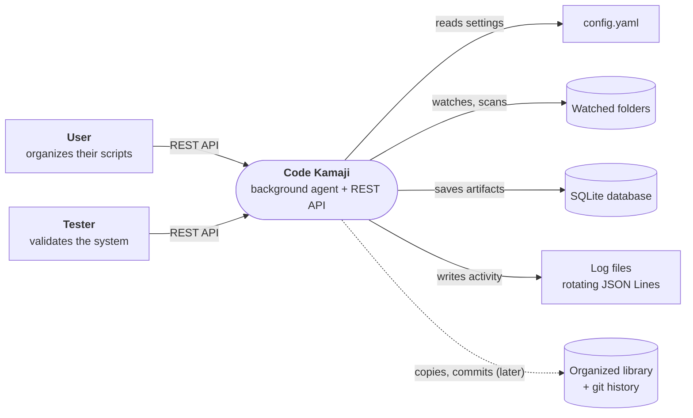

# System context

Who uses Code Kamaji, and what systems it interacts with.

| Actor  | Goal                                   | Uses                                       |
| ------ | -------------------------------------- | ------------------------------------------ |
| User   | Keep their scripts found and organized | Browser (`/docs`), curl, `config.yaml`     |
| Tester | Check the system behaves as specified  | Same API, plus test-only endpoints (later) |

- **Watched folders**: read-only. Code Kamaji never runs, moves or changes the originals.
- **Protected folders**: system folders (e.g. `C:\Windows`) and `deny_paths` from the config are never read.
- **Local only**: nothing leaves the machine.
- **Low impact**: runs at low CPU and disk priority.
- **Logs**: kept out of SQLite so they still work when the DB fails.
