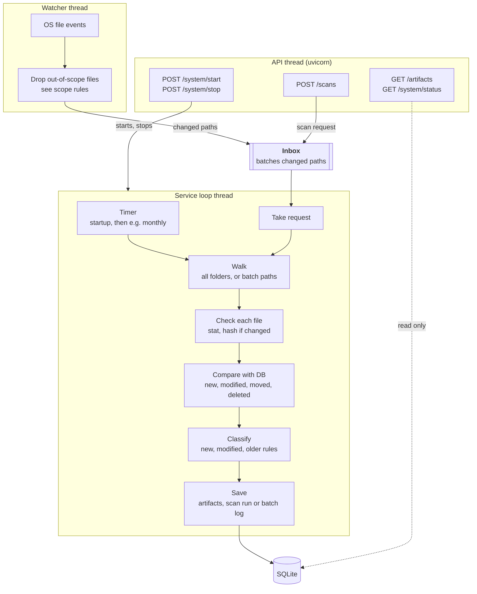

# Data flow

How files become saved artifacts, and which thread does each step.

## What starts a scan

- **Timer**: a full scan at startup, then every `full_scan_interval_days`, e.g. 30. Catches what the watcher missed.
- **First scan vs later**: same code. The first scan hashes every file, so it can take weeks. Later ones only hash files whose size or `modified_at` changed, but still walk everything: skipping the walk needs the OS change log, which needs admin.
- **Watcher**: changed paths go to the inbox. It hands them over as a batch at N paths, after a few quiet seconds, or after a max wait, whichever comes first (all set in the config).
- **API**: `POST /scans` puts a scan request in the inbox.
- **New watched folder**: gets its own scan, since its existing files fire no events.

## Steps

- **Scope rules**: `services/rules/scope.py` skips excluded and protected folders, temp files and symlinks. Used by the watcher (passed in by `main.py`), the walk and the API.
- **Walk**: a full scan walks every watched folder. A batch only checks its own paths. A moved or deleted folder counts as every path under it.
- **Check each file**: hash only if size or `modified_at` changed.
- **Compare with DB**: sorts files into new, modified, moved and deleted. A batch only judges its own paths. A move is one path vanishing and another appearing in the same batch.
- **Classify**: new and modified files, plus files classified by older rules (`classifier_version`).
- **Save**: in chunks, so a long scan shows progress. Full scans get a scan run. Batches get a log line instead, e.g. paths checked, changes, duration.

## Ownership

- **Service loop**: the only DB writer, and the only thing that scans. Runs at low CPU and disk priority.
- **Watcher thread**: drops ignored events and queues the rest. Never scans, never touches the DB.
- **API thread**: reads the DB through services, sends scan requests, starts and stops the loop.
