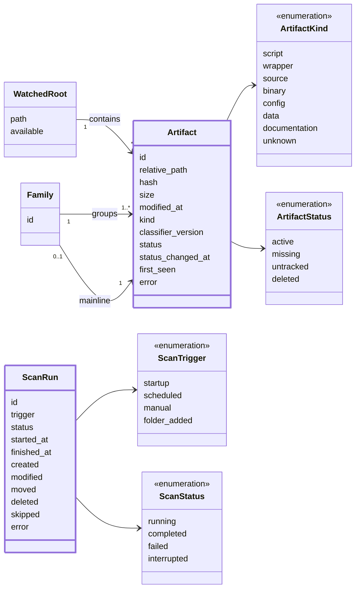

# Domain model

Core concepts and how they relate. Fields only, no methods.

| Concept     | What it is                                                                  |
| ----------- | --------------------------------------------------------------------------- |
| WatchedRoot | Folder from `config.yaml`, and whether it's reachable                       |
| Artifact    | One tracked file. Keeps its `id` through edits and renames                  |
| Family      | Copies of the same script: one mainline (main version) + sidings (variants) |
| ScanRun     | One full scan: trigger, outcome, timing, change counts                      |

## Fields

- **`WatchedRoot.path` + `relative_path`**: the artifact's full location.
- **`id`**: not derived from the path, so it survives renames.
- **`hash`**: content fingerprint. Empty for files over the size limit.
- **`size` + `modified_at`**: if both are unchanged, the file isn't hashed again.
- **`kind`**: what the file is (`ArtifactKind`).
  - **`script`**: code you run directly, e.g. `backup.py`, `deploy.sh`.
  - **`wrapper`**: a small script that runs another program, e.g. `run_backup.bat`.
  - **`source`**: code that's part of a bigger program, imported or compiled, e.g. `models.py`, `User.java`.
  - **`binary`**: a compiled program, e.g. `.exe`, `.jar`.
  - **`config`**: settings files, e.g. `.yaml`, `.ini`, `package.json`.
  - **`data`**: input or output files, e.g. `.csv`, `.json`.
  - **`documentation`**: notes and READMEs, e.g. `README.md`.
  - **`unknown`**: anything Code Kamaji can't classify yet.
- **`classifier_version`**: version of the rules that set `kind`. Better rules only redo older results.
- **`status`**: see [states](states.md).
- **`error`**: last problem reading the file, e.g. permission denied. Not a state.

## Rules

- **Family**: every artifact starts as its own family. Grouping merges families.

## Not in the model

- **Inbox items** (scan requests, event batches): short-lived, never saved.
- **Old file versions**: kept by git in the organized library (later).
- **Project** (later): files that work together, e.g. a repo. Groups artifacts, since a family's copies can span projects.
