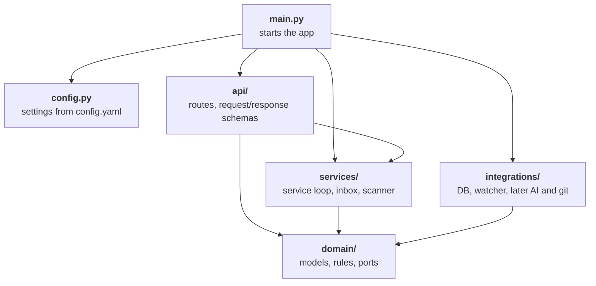

# Code layers

How the code is split. Arrows show imports.



## Rules

- **`main.py`**: creates every object and passes in what each one needs.
- **`config.py`**: only `main.py` reads it.
- **`api/`**: GET routes read the DB through the store port. POST routes (`/scans`, `/system/start`, `/system/stop`) call services.
- **`services/`**: uses the DB and the watcher only through ports. Reading files directly is fine.
- **`domain/`**: imports no other layer and does no I/O. E.g. `classify` gets a file's first bytes, it never opens the file.
- **`integrations/`**: implements the ports, one folder per external system.
- **Checked in CI**: `lint-imports` fails if code breaks these import rules. Contracts live in `pyproject.toml`.

## Ports

- **What**: interfaces in `domain/ports.py`, e.g. `ArtifactStore` lists what a store can do (save, get), not how.
- **Why**: tests can use fakes, e.g. an in-memory store or a watcher that sends fake events.

## What lives where

```
app/
├── main.py              # loads config, builds everything, starts the loop and the API
├── config.py            # settings model, loads config.yaml
├── api/
│   ├── artifacts.py     # /artifacts routes and their request/response schemas
│   ├── scans.py         # /scans
│   ├── system.py        # /system/status, /system/start, /system/stop
│   └── logs.py          # /logs
├── services/
│   ├── agent.py         # service loop and its lifecycle (start, stop)
│   ├── inbox.py         # batches changed paths and scan requests
│   └── scanner.py       # walks folders, hashes files, finds what changed
├── domain/
│   ├── models.py        # Artifact, Family, ScanRun, WatchedRoot
│   ├── identity.py      # when two files are the same artifact
│   ├── classify.py      # script, wrapper, binary, ... from a name and first bytes
│   ├── scope.py         # which paths are in scope (excludes, protected folders, symlinks)
│   └── ports.py         # interfaces: ArtifactStore, FileWatcher
└── integrations/
    ├── db/              # ArtifactStore backed by SQLite
    ├── watcher/         # FileWatcher backed by watchdog
    ├── ai/              # later: AI providers
    └── git/             # later: versioning the organized library

tests/
├── domain/              # pure functions, no setup
├── services/            # fake store and watcher, temp folders
├── integrations/        # real SQLite and watchdog, temp folders
└── api/                 # FastAPI TestClient
```

- **`api/`**: one file per resource, with its routes and schemas together. A big resource can become a folder.
- **`tests/`**: mirrors the layers, so each folder has one kind of test.
- **File names**: can change. This is not a contract.
