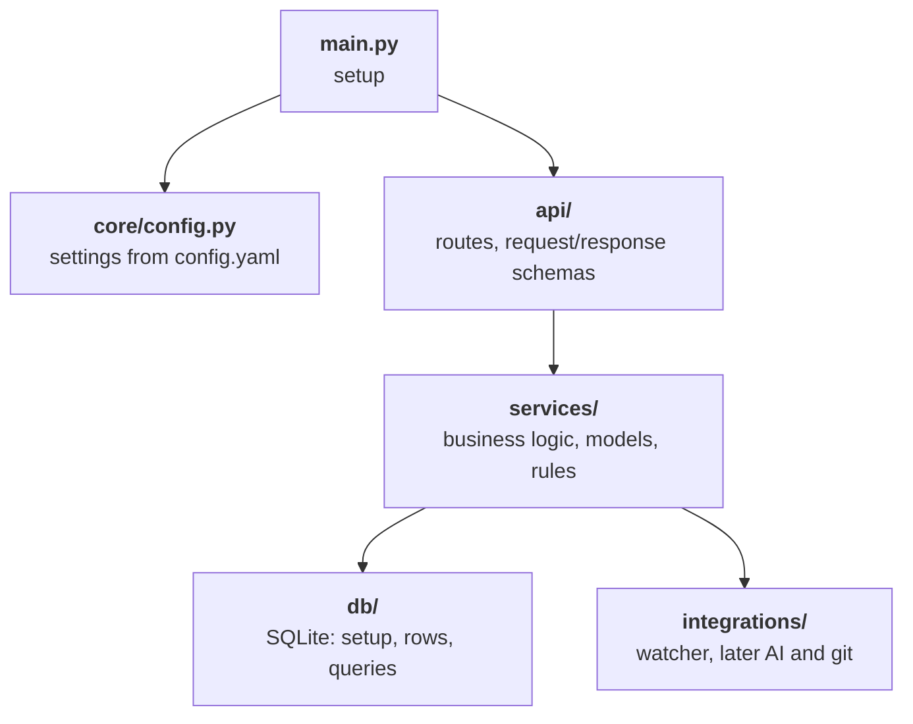

# Code layers

How the code is split. Arrows show imports. `main.py` also imports services, `db/` and integrations (arrows left out).



## Rules

- **`main.py`**: loads the config, opens the DB, creates the watcher and services, starts and stops them, builds the app.
- **`core/config.py`**: only `main.py` uses it.
- **`api/`**: routes call services. Never touches the DB or integrations.
- **`services/`**: business logic only. Gets the DB, integrations and the settings it needs from `main.py`.
- **`db/`**: Code Kamaji's own storage. Imports no other layer.
- **`integrations/`**: talks to one external system each. Imports no other layer.
- **Checked in CI**: by `lint-imports`.

## Models per layer

Each layer has its own models.

| Layer           | Model              | Shape of                      |
| --------------- | ------------------ | ----------------------------- |
| `api/`          | `ArtifactResponse` | The JSON testers see          |
| `services/`     | `Artifact`         | What the business logic uses  |
| `db/`           | `ArtifactRow`      | How the DB stores it          |

- **Converting**: services turn rows into `Artifact`, the API turns `Artifact` into responses.
- **Why**: DB changes stay in `db/`, internal fields stay out of the JSON.

## What lives where

```
app/
├── main.py              # setup: config, DB, watcher, services, the API
├── core/
│   └── config.py        # settings model, loads config.yaml
├── api/
│   ├── deps.py          # Depends functions that hand routes the services
│   └── routes/
│       ├── artifacts.py # /artifacts routes and their request/response schemas
│       ├── scans.py     # /scans
│       ├── system.py    # /system/health, /system/status, /system/start, /system/stop
│       └── logs.py      # /logs
├── services/
│   ├── models.py        # Artifact, Family, ScanRun, WatchedRoot
│   ├── agent.py         # the service loop
│   ├── inbox.py         # batches changed paths and scan requests
│   ├── scanner.py       # walks folders, hashes files, finds what changed
│   └── rules/
│       ├── scope.py     # should this path be scanned?
│       ├── classify.py  # what kind of file is this?
│       └── identity.py  # is this the same file as before?
├── db/
│   ├── database.py      # opens the SQLite file, creates the tables
│   ├── rows.py          # row classes, e.g. ArtifactRow
│   └── artifacts.py     # artifact queries: save, get, list
└── integrations/
    ├── watcher/         # OS file events via watchdog
    ├── ai/              # later: AI providers
    └── git/             # later: versioning the organized library

tests/
├── services/            # temp SQLite, fake events
├── db/                  # temp SQLite
├── integrations/        # real watchdog
└── api/                 # FastAPI TestClient
```

- **`api/routes/`**: one file per resource, with its routes and schemas together.
- **`services/rules/`**: pure functions, no I/O.
- **`db/`**: one query file per table.
- **`tests/`**: mirrors the layers, so each folder has one kind of test.
- **File names**: can change. This is not a contract.
