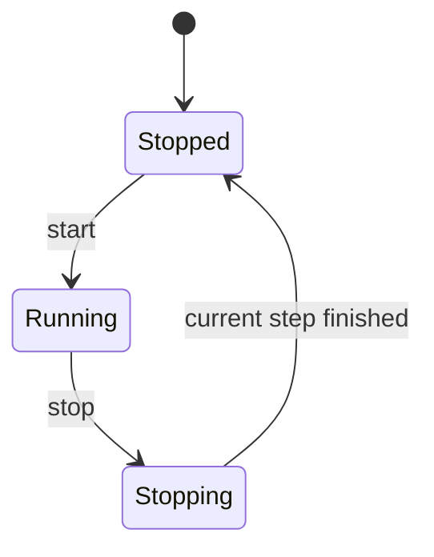
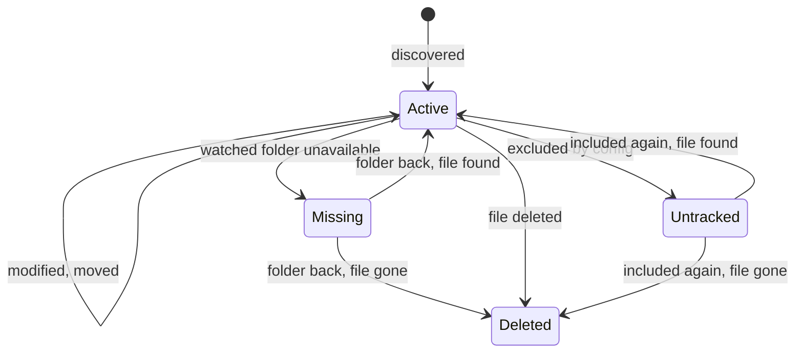
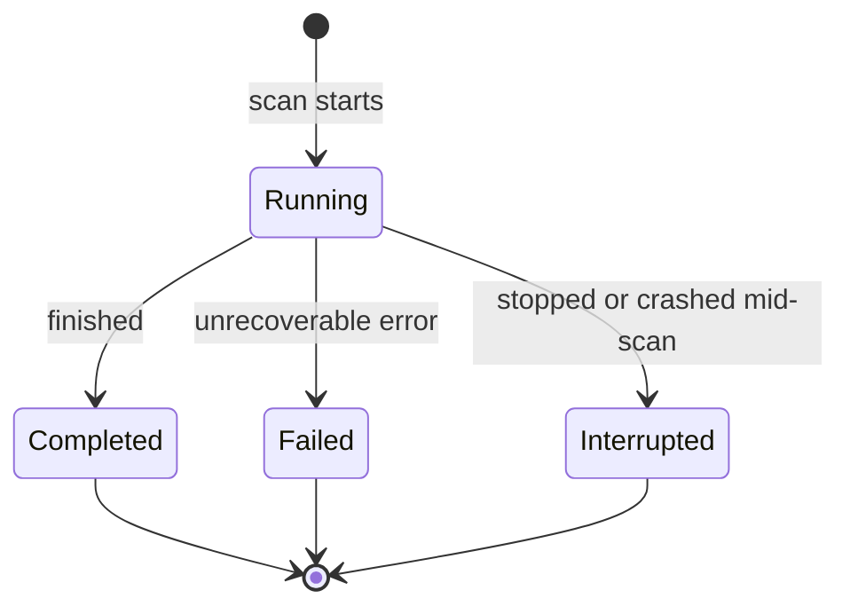

# State machines

What changes state, and when.

| Machine  | Tracks                   | How many          | Saved           |
| -------- | ------------------------ | ----------------- | --------------- |
| Service  | Is the agent on?         | One               | No, memory only |
| Artifact | What happened to a file? | One per file      | Yes             |
| Scan     | How did a full scan end? | One per full scan | Yes             |

## Service

| State    | Watches files | Scans                      | Accepted commands |
| -------- | ------------- | -------------------------- | ----------------- |
| Stopped  | No            | No                         | start             |
| Running  | Yes           | Yes                        | stop, scan        |
| Stopping | No            | Finishing the current step | none              |

- **Stopping**: `start` is rejected until the current step finishes, so two loops never run at once.
- **Ctrl+C**: the FastAPI shutdown handler calls `stop()` and waits.
- **Errors**: if a step fails, e.g. DB locked, the loop retries later with growing pauses instead of stopping.
- **Crash**: the process just ends. State is in memory, so nothing to clean up.
- **While stopped**: changes aren't seen. The startup scan catches up.

## Artifact

| State     | Meaning                                          |
| --------- | ------------------------------------------------ |
| Active    | Tracked and up to date                           |
| Missing   | Watched folder unavailable, e.g. unplugged drive |
| Untracked | Still exists, but excluded by config             |
| Deleted   | Gone from disk                                   |

- **Records**: never removed. An artifact keeps its ID through every state.
- **History**: the DB keeps the identity, git (later) keeps the content.

## Scan

| State       | Meaning                                               | Needs attention |
| ----------- | ----------------------------------------------------- | --------------- |
| Running     | In progress                                           | No              |
| Completed   | Finished. Unreadable files are skipped and counted    | No              |
| Failed      | Hit an error it can't work around, e.g. DB unwritable | Yes             |
| Interrupted | Stopped from outside: stop, Ctrl+C, crash             | No              |

- **Full scans only**: event batches get a log line instead, to keep thousands of rows out of the DB.
- **Created**: when the scan starts. Requested scans wait in the inbox until then.
- **Failed**: set by the scan when it catches the error.
- **Interrupted**: set on stop, or on the next startup for runs a crash left marked Running.
